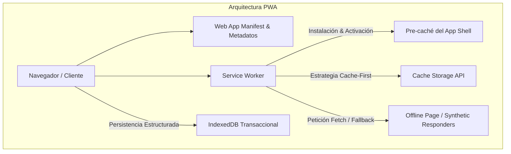

# 📱 Portafolio de Ejercicios 1 – Configuración Base y Componentes PWA

Repositorio que reúne los 5 ejercicios prácticos para la construcción, ciclo de vida, almacenamiento y resiliencia offline de **Progressive Web Apps (PWA)** modernas, utilizando tecnologías web estándar (HTML5, CSS3 Vanilla, JavaScript ES6+, Service Workers, Cache API e IndexedDB).

---

## 📑 Tabla de Contenidos
1. [Descripción General](#-descripción-general)
2. [Estructura del Repositorio](#-estructura-del-repositorio)
3. [Resumen de los Ejercicios](#-resumen-de-los-ejercicios)
   - [Ejercicio 1: Web App Manifest y Metadatos PWA](#ejercicio-1-web-app-manifest-y-metadatos-pwa)
   - [Ejercicio 2: Arquitectura App Shell y Splash Screen](#ejercicio-2-arquitectura-app-shell-y-splash-screen)
   - [Ejercicio 3: Service Worker Avanzado e IndexedDB](#ejercicio-3-service-worker-avanzado-e-indexeddb)
   - [Ejercicio 4: Cache API y Estrategia Cache-First](#ejercicio-4-cache-api-y-estrategia-cache-first)
   - [Ejercicio 5: Interceptor de Peticiones y Respuestas Offline](#ejercicio-5-interceptor-de-peticiones-y-respuestas-offline)
4. [Estrategia de Versionamiento y Ramas](#-estrategia-de-versionamiento-y-ramas)
5. [Requisitos y Guía de Ejecución](#-requisitos-y-guía-de-ejecución)
6. [Convención de Commits](#-convención-de-commits)

---

## 🌟 Descripción General

Este portafolio aborda progresivamente los pilares fundamentales para convertir aplicaciones web en experiencias instalables, confiables e independientes de la red:



---

## 📂 Estructura del Repositorio

El repositorio se encuentra estructurado en carpetas independientes para cada ejercicio, garantizando portabilidad y aislamiento de dependencias:

```text
Portafolio-de-Ejercicios-1-Configuraci-n-Base-y-Componentes-PWA/
├── .gitignore                      # Exclusiones de Git (node_modules, logs, OS files)
├── README.md                       # Documentación global del portafolio
│
├── Ejercicio1/                     # Ejercicio 1: Manifest y Metadatos de Instalación
│   ├── icons/                      # Iconos adaptativos (192x192, 512x512)
│   ├── app.js                      # Lógica interactiva y beforeinstallprompt
│   ├── index.html                  # HTML con metaetiquetas e interfaz de auditoría
│   ├── manifest.json               # Configuración oficial de Web App Manifest
│   ├── style.css                   # Diseño CSS responsivo y dark mode
│   └── README.md                   # Documentación específica del Ejercicio 1
│
├── Ejercicio2/                     # Ejercicio 2: App Shell y Splash Screen
│   ├── icons/                      # Iconos estándar y maskables
│   ├── app.js                      # Registro de SW y controlador de vistas
│   ├── generate_icons.js           # Generador de assets de icono
│   ├── index.html                  # Maqueta estructural del App Shell
│   ├── manifest.json               # Configuración de Splash Screen nativa
│   ├── package.json                # Servidor Express
│   ├── server.js                   # Servidor local Node.js
│   ├── style.css                   # Skeleton loaders y estilos del App Shell
│   ├── sw.js                       # Service Worker con precaché y ciclo de vida
│   └── README.md                   # Documentación específica del Ejercicio 2
│
├── Ejercicio3/                     # Ejercicio 3: Persistencia Offline con IndexedDB
│   ├── icons/                      # Iconos PNG y SVG
│   ├── js/
│   │   ├── app.js                  # Lógica de usuario y detector online/offline
│   │   └── db.js                   # Capa de abstracción IndexedDB basada en Promises
│   ├── generate_icons.js           # Generador de iconos
│   ├── index.html                  # Dashboard interactivo CRUD offline
│   ├── manifest.json               # Configuración PWA
│   ├── package.json                # Servidor Express
│   ├── server.js                   # Servidor Node.js
│   ├── styles.css                  # Estilos visuales Glassmorphism
│   ├── sw.js                       # Service Worker avanzado
│   └── README.md                   # Documentación específica del Ejercicio 3
│
├── Ejercicio4/                     # Ejercicio 4: Cache API y Cache-First
│   ├── icons/                      # Iconos de aplicación
│   ├── images/                     # Assets del App Shell (SVG, banner)
│   ├── app.js                      # Explorador interactivo de Cache Storage
│   ├── generate_icons.js           # Utilidad de iconos
│   ├── index.html                  # Consola interactiva de auditoría de caché
│   ├── manifest.json               # Configuración de la PWA
│   ├── styles.css                  # Estilos de consola y monitor de caché
│   ├── sw.js                       # Service Worker con estrategia Cache-First
│   └── README.md                   # Documentación específica del Ejercicio 4
│
└── Ejercicio5/                     # Ejercicio 5: Interceptor y Respuestas Offline
    ├── icons/                      # Iconos de aplicación
    ├── app.js                      # Disparador de peticiones y monitor en vivo
    ├── generate_icons.js           # Utilidad de iconos
    ├── index.html                  # Simulador de fallos de red y contingencia
    ├── manifest.json               # Configuración PWA
    ├── offline.html                # Plantilla de rescate para navegación offline
    ├── styles.css                  # Estilos visuales
    ├── sw.js                       # Interceptor fetch con fallbacks sintéticos
    └── README.md                   # Documentación específica del Ejercicio 5
```

---

## 🔍 Resumen de los Ejercicios

### Ejercicio 1: Web App Manifest y Metadatos PWA
- **Objetivo**: Configuración del `manifest.json`, iconos adaptativos (`any` y `maskable`) y metadatos multiplataforma para navegadores modernos e iOS.
- **Aspectos Destacados**: Captura del evento `beforeinstallprompt`, auditoría de campos del manifest y panel interactivo para copiar y probar configuraciones.

### Ejercicio 2: Arquitectura App Shell y Splash Screen
- **Objetivo**: Separar la carcasa estructural fija (App Shell) del contenido dinámico, garantizando carga instantánea desde caché y visualización de Splash Screen.
- **Aspectos Destacados**: Service Worker con precaché en `install`, eliminación de cachés antiguas en `activate` y visualización de skeleton loaders.

### Ejercicio 3: Service Worker Avanzado e IndexedDB
- **Objetivo**: Proporcionar persistencia transaccional y estructurada en cliente con IndexedDB mientras la interfaz es servida por el Service Worker.
- **Aspectos Destacados**: Creación de `ObjectStores`, índices, operaciones CRUD completas y soporte 100% desconectado con detección automática de red (`navigator.onLine`).

### Ejercicio 4: Cache API y Estrategia Cache-First
- **Objetivo**: Dominar los métodos de la `Cache API` (`open`, `addAll`, `match`, `delete`, `keys`) implementando la estrategia Cache-First para el App Shell.
- **Aspectos Destacados**: Monitor visual en tiempo real para inspeccionar el contenido de la memoria caché y métricas de tiempo de entrega.

### Ejercicio 5: Interceptor de Peticiones y Respuestas Offline
- **Objetivo**: Interceptar peticiones mediante el evento `fetch` del Service Worker y responder con alternativas de rescate según el tipo de solicitud.
- **Aspectos Destacados**: Fallback de página HTML (`offline.html`) para navegación, respuestas SVG sintéticas para imágenes y respuestas JSON para endpoints desconectados.

---

## 🌿 Estrategia de Versionamiento y Ramas

Para mantener un historial limpio, trazable y modular, el repositorio cuenta con una rama principal y ramas de versionamiento específicas para cada ejercicio:

| Rama | Descripción | Contenido / Alcance |
| :--- | :--- | :--- |
| `main` | Rama productiva principal | Contiene los 5 ejercicios unificados con la documentación global. |
| `ejercicio-1` | Versión enfocada en Ejercicio 1 | Configuración de `manifest.json`, iconos y metadatos de instalación. |
| `ejercicio-2` | Versión enfocada en Ejercicio 2 | Arquitectura App Shell, Splash Screen y Service Worker inicial. |
| `ejercicio-3` | Versión enfocada en Ejercicio 3 | Persistencia de datos transaccional con IndexedDB y Service Worker. |
| `ejercicio-4` | Versión enfocada en Ejercicio 4 | Cache API y estrategia Cache-First con consola interactiva. |
| `ejercicio-5` | Versión enfocada en Ejercicio 5 | Intercepción de peticiones `fetch` y respuestas alternativas offline. |

---

## 💻 Requisitos y Guía de Ejecución

### Prerrequisitos
- **Node.js** (v16.0 o superior) y **npm** instalados.
- Navegador moderno con soporte para Service Workers (Google Chrome, Microsoft Edge, Mozilla Firefox o Safari 11.1+).

### Ejecutar cualquier ejercicio con un servidor estático
Puedes servir de forma independiente cualquiera de los ejercicios:
```bash
# Ejemplo: Servir el Ejercicio 1
cd Ejercicio1
npx serve .

# Ejemplo: Servir el Ejercicio 4
cd Ejercicio4
npx serve .
```

### Ejecutar ejercicios con servidor Node.js/Express (Ejercicios 2 y 3)
```bash
# Para el Ejercicio 2
cd Ejercicio2
npm install
npm start

# Para el Ejercicio 3
cd Ejercicio3
npm install
npm start
```

---

## 📝 Convención de Commits

Los commits siguen el estándar [Conventional Commits](https://www.conventionalcommits.org/):

- `feat(ejercicio-1): ...` Nuevas características o implementaciones del ejercicio 1.
- `feat(ejercicio-2): ...` Nuevas características o implementaciones del ejercicio 2.
- `feat(ejercicio-3): ...` Nuevas características o implementaciones del ejercicio 3.
- `feat(ejercicio-4): ...` Nuevas características o implementaciones del ejercicio 4.
- `feat(ejercicio-5): ...` Nuevas características o implementaciones del ejercicio 5.
- `docs: ...` Adición o actualización de documentación técnica y READMEs.
- `chore: ...` Tareas de mantenimiento, configuración de Git y repositorios.
